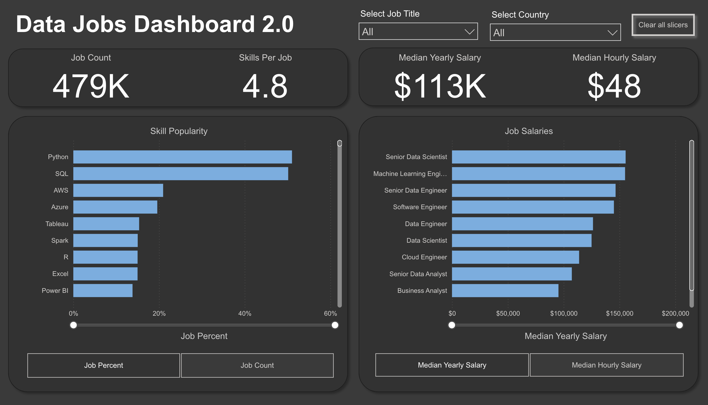

# Power BI Projects — Data Jobs Dashboards

Two interactive Power BI dashboards built on a real-world dataset of **2024 data job postings** (job titles, salaries, locations, skills). They help job seekers answer: *which data roles pay the most, where are the jobs, and which skills should I learn?*

| Project | What's inside |
|---|---|
| [Project 1 – Data Jobs Dashboard](_Project_1/) | 2-page report: market overview + drill-through page per job title, maps, bookmarks |
| [Project 2 – Data Jobs Dashboard 2.0](_Project_2/) | Single-page redesign with a star-schema model and DAX measures (median salary, skills per job) |

**Skills:** Power Query (ETL) · data modeling (star schema) · DAX · drill-through · bookmarks & buttons · slicers · map charts · dashboard design

---
*Built while following Luke Barousse's Power BI course (dataset from the course); report design and write-ups are my own.*
