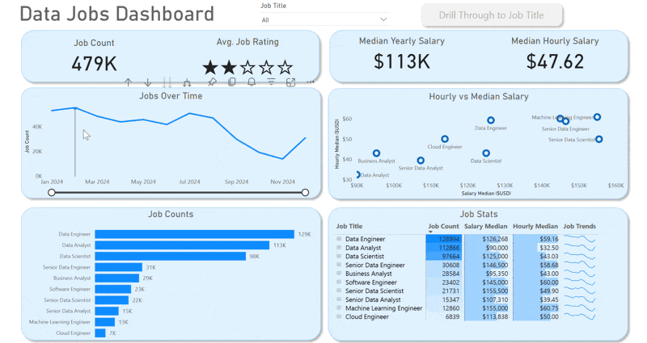
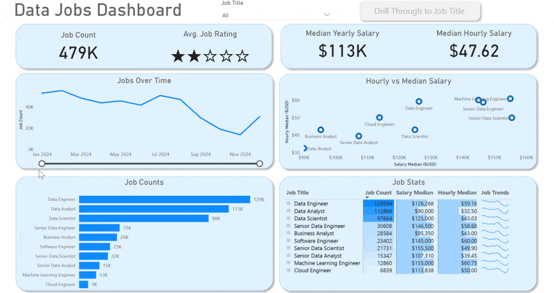
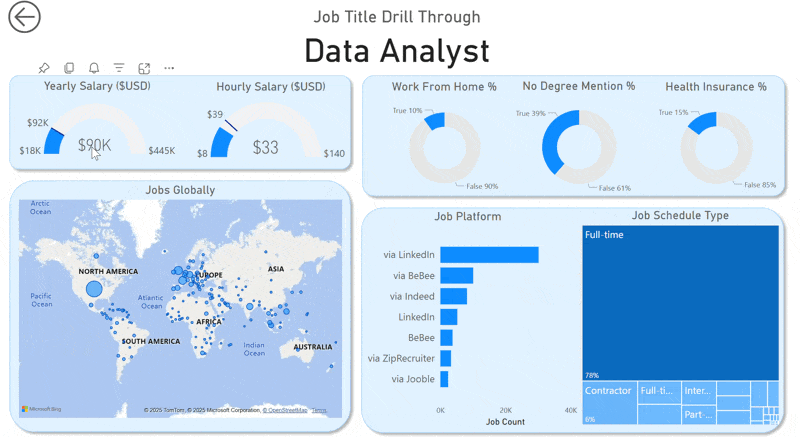

# Data Jobs Dashboard (Power BI)

## Why I built it
Salary and job-market information for data roles is scattered across many sites. I wanted one report where a job seeker can compare data roles by **number of jobs, salary, location and work-from-home options** in a few clicks.

**Data:** real-world 2024 data job postings (job titles, salaries, locations, platforms).
**File:** [`Data_Jobs_Dashboard.pbix`](Data_Jobs_Dashboard.pbix)

## What I did
- **Cleaned the data in Power Query:** handled blanks, fixed data types and added calculated columns.
- **Created measures** such as `Median Yearly Salary` and `Job Count`.
- **Built the visuals:** column, bar, line and area charts for comparisons and trends, a map of job locations, KPI cards and a detail table.
- **Made it interactive:** a job-title slicer, buttons and bookmarks for navigation, and drill-through from the overview to a detail page.

## Report pages

### Page 1 – Market overview

Total job count, median salaries and top job titles at a glance.

### Page 2 – Job title drill-through

Right-click a job title on page 1 to open its details: salary range, share of remote jobs, top hiring platforms and a world map of job locations.

## What I learned
Designing for a specific user (a job seeker) made me choose fewer, clearer visuals, and drill-through turned out to be the simplest way to keep the main page clean while still offering detail.
