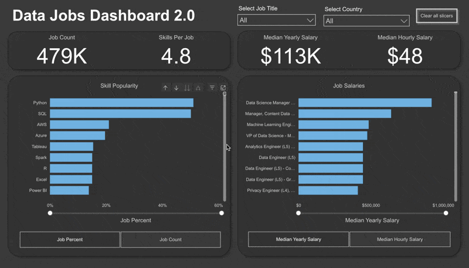
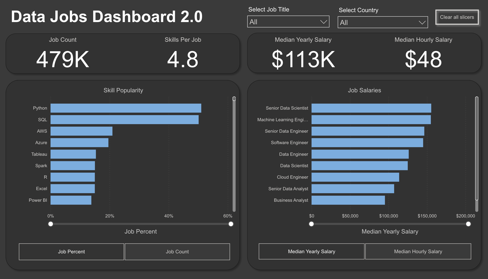

# Data Jobs Dashboard 2.0 (Power BI)

## Why a version 2.0
After my [first dashboard](../_Project_1/) I wanted a faster experience: **everything a job seeker needs on a single page**, backed by a proper data model instead of one flat table.

**Data:** real-world 2024 data job postings (job titles, salaries, locations, skills).
**File:** [`Data_Jobs_Dashboard_2.0.pbix`](Data_Jobs_Dashboard_2.0.pbix)

## What I did
- **Power Query (ETL):** cleaned and reshaped the postings and the skills data.
- **Data model:** related the tables using star-schema principles.
- **DAX measures:** job count, skills per job, median yearly salary and median hourly salary.
- **Visuals:** KPI cards, skill popularity (by % of jobs or by count), salary comparison by job title, map and detail table.
- **Interactivity:** slicers, plus buttons and bookmarks to switch views.

## The dashboard

One page shows the KPIs (**Job Count, Skills per Job, Median Yearly Salary, Median Hourly Salary**), which skills are most requested and how salaries compare across job titles.

## What I learned
Moving from a flat table to a related data model made the DAX measures simpler, and fitting everything on one page forced me to keep only the visuals that answer a real question.
